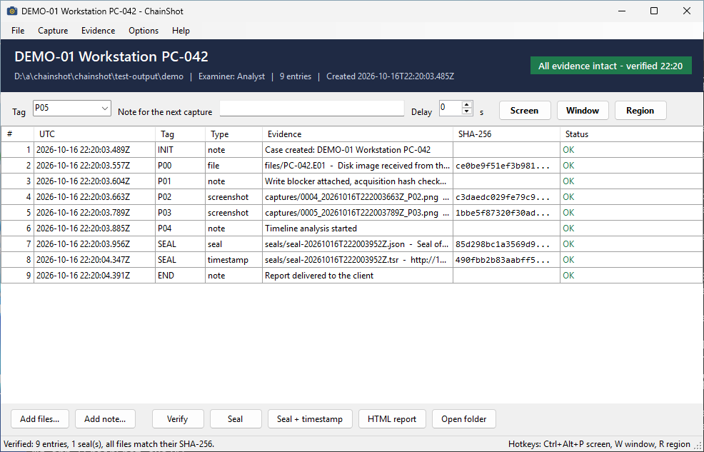
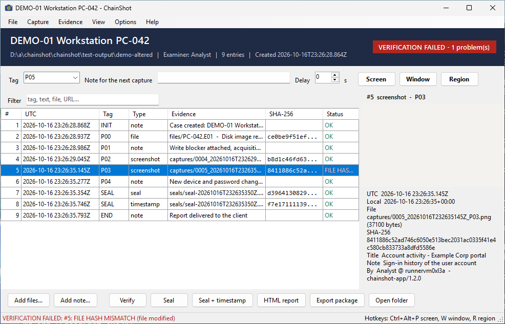
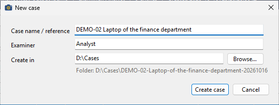
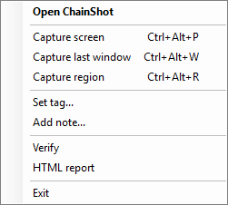
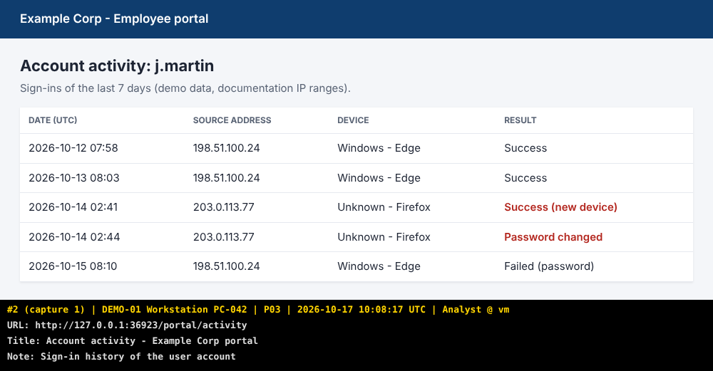
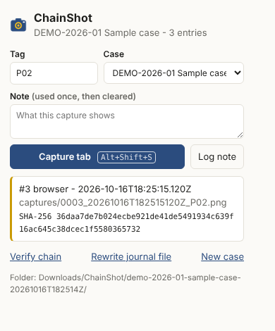
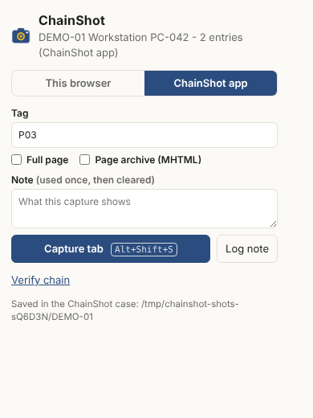
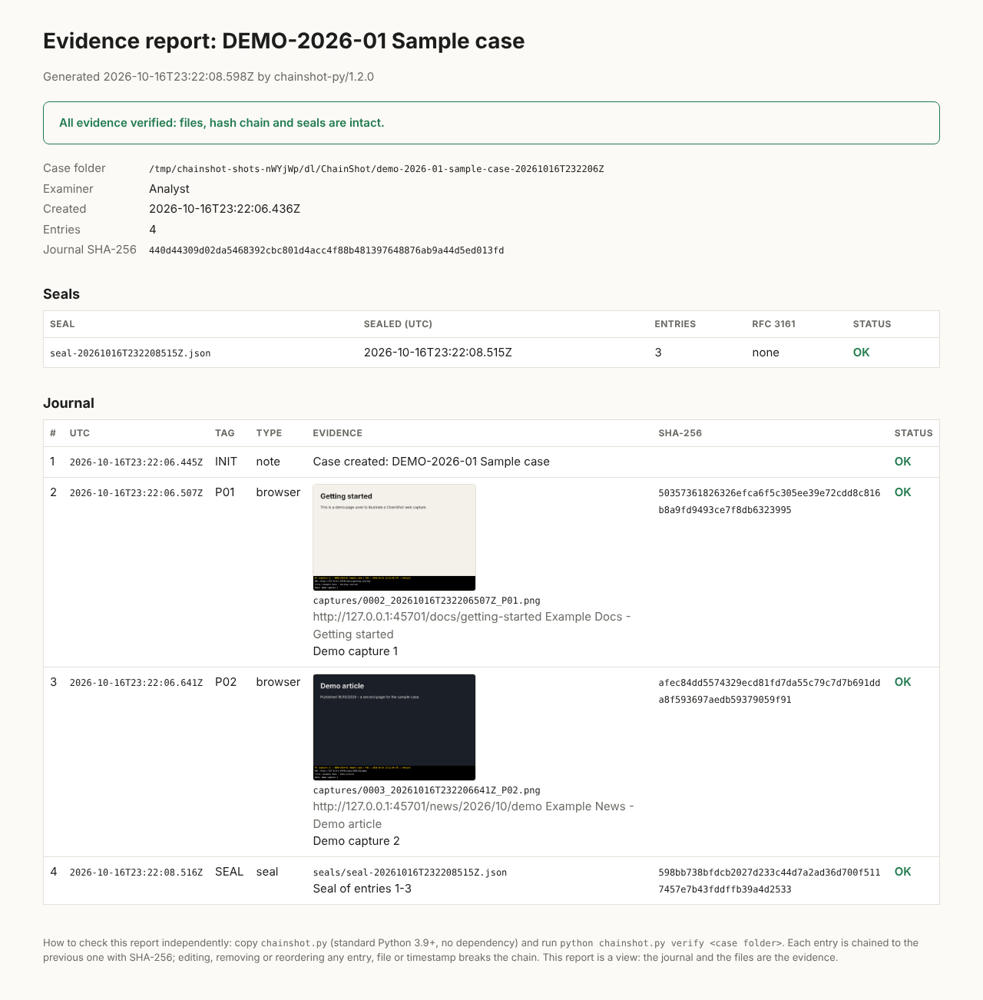

<p align="center">
  
</p>

<h1 align="center">ChainShot</h1>

<p align="center">
  <b>Captures d'écran horodatées et chaînées par hash, pour les rapports forensic et d'investigation.</b><br>
  Chaque capture est hachée, chaînée à la précédente, scellée et vérifiable par n'importe qui.
</p>

<p align="center">
  <a href="PRIVACY.md"></a>
  
</p>

<p align="center"><a href="https://dalkin69.github.io/chainshot/fr/"><b>Site web</b></a> · <a href="README.md">Read in English</a></p>

---

Une capture d'écran collée dans un rapport ne prouve rien à elle seule : elle peut être retouchée, re-datée ou
remplacée. ChainShot fait de chaque capture une preuve que n'importe qui peut contrôler plus tard :

- un **bandeau sous l'image** (jamais par-dessus) : n° d'entrée, cas, tag, heure UTC et locale, examinateur, poste ;
- le **SHA-256** du PNG, inscrit dans un journal en ajout seul ;
- une **chaîne de hash** qui couvre aussi l'heure, le tag et les notes : modifier, supprimer ou réordonner une entrée se voit ;
- des **scellés** qui certifient le journal à un instant donné, avec en option un **horodatage RFC 3161** par une autorité indépendante ;
- un **vérificateur qui n'a besoin que de Python** : le client ou l'auditeur n'a pas à faire confiance à l'outil de capture.

Le projet est né pendant un cours d'analyse forensic, d'un petit script PowerShell utilisé pour documenter une
analyse Autopsy, puis il est devenu une boîte à outils.

> **Confidentiel par conception, open source.** Aucune télémétrie, aucune statistique d'usage, aucun compte, aucune
> vérification de mise à jour : ChainShot ne se connecte jamais à Internet de lui-même et vos captures ne quittent pas
> votre ordinateur. La seule requête réseau est l'horodatage RFC 3161 optionnel, qui n'envoie que le SHA-256 d'un
> fichier de scellé. Tout le code source est ici sous licence MIT, et chaque version est construite à partir de lui
> par le workflow public GitHub Actions, avec ses sommes SHA-256. Détails : [PRIVACY.md](PRIVACY.md) (en anglais).

## Composants

| Composant | Plateforme | Rôle |
| --- | --- | --- |
| [**Application ChainShot**](app/) (`ChainShot.exe`) | Windows 10/11, un seul fichier, rien à installer | L'outil Windows principal : création de cas, captures écran, fenêtre et zone avec raccourcis globaux, tags, notes, hachage de fichiers par glisser-déposer, vérification, scellés RFC 3161, rapport HTML, icône de notification ; ligne de commande incluse |
| [**Module PowerShell**](windows/) | Windows PowerShell 5.1 ou 7 | Les mêmes fonctions depuis PowerShell, pour les scripts et les adeptes de la ligne de commande, avec sa propre icône de notification |
| [**Extension navigateur**](extension/) | Chrome, Edge, Brave (Chromium 116+), Firefox 140+ | Capture la zone visible ou la **page entière** avec son URL et son titre, **archive MHTML** de la page en option (Chromium), dans un cas du dossier Téléchargements ou directement dans le cas ouvert dans l'application |
| [**`chainshot.py`**](python/) | Tout OS, Python 3.9+, sans dépendance | Implémentation de référence : vérification, scellés RFC 3161, rapport HTML, export CSV, ajout de fichiers et de notes |

Les quatre écrivent **le même format de journal** ([spécification, en anglais](docs/journal-format.md)) et sont
testés sur les mêmes vecteurs : un cas commencé dans l'application peut être poursuivi en PowerShell ou avec
l'extension, et vérifié partout.

## Captures d'écran

**L'application** : le cas, son badge de vérification, le tag et la note de la prochaine capture, le journal avec
son filtre, et l'aperçu de la capture sélectionnée avec son hash.



**Un fichier modifié est détecté** : le même cas après la modification de quelques octets d'une capture. Le badge,
la ligne et la barre d'état indiquent quelle preuve ne correspond plus à son SHA-256.



| Nouveau cas | Menu de l'icône (les raccourcis marchent depuis toute application) |
| --- | --- |
|  |  |

**L'extension navigateur**, dans son propre cas ou dans le cas ouvert dans l'application :

| Capture web avec son bandeau | Fenêtre | Fenêtre liée à l'application |
| --- | --- | --- |
|  |  |  |

**Le rapport HTML**, lisible par tous, régénéré à partir du journal :



## Fonctionnement

1. **Capture** : l'image reçoit un bandeau *en dessous*, aucun pixel capturé n'est masqué.
2. **Hash** : le SHA-256 du PNG final est enregistré avec sa taille.
3. **Chaîne** : l'entrée (heure, type, tag, fichier, hash, examinateur, poste, URL, titre, note) est mise sous une
   forme canonique, hachée, puis combinée à la valeur de chaîne précédente. Modifier quoi que ce soit dans une entrée
   casse tous les maillons suivants.
4. **Scellé** : à tout moment (fin de session, avant remise), un scellé enregistre le nombre d'entrées, la dernière
   valeur de chaîne et le hash du journal à cet instant. Son SHA-256 est la valeur à écrire dans le rapport signé ou à
   envoyer au client par un autre canal.
5. **Horodatage** (optionnel) : le hash du scellé est envoyé à une autorité d'horodatage RFC 3161, qui le signe avec
   sa propre horloge. C'est la réponse à la principale faiblesse de l'horodatage local : l'horloge de votre PC.
6. **Vérification** : n'importe qui relance `chainshot.py verify` sur le dossier.

## Démarrage rapide

### Windows : l'application ChainShot

1. Installez-le avec un gestionnaire de paquets, ou téléchargez `chainshot-app-*.zip` depuis la dernière
   [release](https://github.com/Dalkin69/chainshot/releases), décompressez-le et lancez `ChainShot.exe` (rien à installer,
   pas de droits administrateur).

   ```powershell
   winget install Dalkin69.ChainShot                                   # après validation dans le catalogue winget
   scoop bucket add chainshot https://github.com/Dalkin69/chainshot; scoop install chainshot
   ```

   L'exécutable n'est pas encore signé : si SmartScreen affiche un avertissement, cliquez sur **Informations complémentaires > Exécuter quand même**
   ([pourquoi](app/README.md#install)). Le menu **Options** ajoute ChainShot au menu Démarrer et au démarrage de Windows.
2. **New case...** : nom ou référence du cas et nom de l'examinateur. L'interface est en anglais.
3. Saisissez un **tag** (par exemple `P17`), puis capturez avec les boutons ou les raccourcis, depuis n'importe
   quelle application :

| Raccourci | Capture |
| --- | --- |
| `Ctrl+Alt+P` | écran sous la souris |
| `Ctrl+Alt+W` | fenêtre au premier plan (son titre et son processus sont enregistrés) |
| `Ctrl+Alt+R` | zone : l'écran se fige, tracez un rectangle, `Échap` annule |

4. Glissez des fichiers sur la fenêtre pour les hacher (export Autopsy, image disque), ajoutez des **notes**, puis
   **Verify**, **Seal + timestamp**, ouvrez le **HTML report** et, pour la remise, **Export package**.

Fermer la fenêtre laisse ChainShot dans la zone de notification avec ses raccourcis. Pour le retirer : *Options >
Uninstall from this computer* (ou `ChainShot.exe uninstall`), puis supprimez le fichier ; les dossiers de cas ne sont
jamais touchés. Le [guide de l'application](app/README.md)
(en anglais) détaille les options et la ligne de commande (`ChainShot.exe verify`, `capture`, `seal --tsa`...).

### Windows : module PowerShell

Pour PowerShell et les scripts : le module fait tout ce que fait l'application, et les deux partagent le cas et le
tag courants, on peut donc les combiner. Téléchargez `chainshot-powershell-*.zip`, décompressez-le, puis :

```powershell
powershell -ExecutionPolicy Bypass -File .\Install-ChainShot.ps1          # -Startup pour lancer son icône à l'ouverture de session
New-ChainShotCase -Path D:\Cas\DEMO-01 -Case 'DEMO-01 Poste PC-042' -Examiner 'Votre nom'
Set-ChainShotTag P17
Invoke-ChainShot -Mode Window -Delay 3 -Note 'Autopsy - Installed Programs'
Add-ChainShotFile -Path D:\Export\capture.pcap -Note 'Capture réseau exportée depuis Autopsy'
Add-ChainShotNote 'Début de la recherche par mots-clés sur le profil utilisateur'
Test-ChainShotCase
New-ChainShotSeal
Export-ChainShotReport -Open        # nécessite Python 3.9+
Start-ChainShotTray                 # icône de notification avec les mêmes raccourcis (pas en même temps que l'application)
```

`Uninstall-ChainShot.ps1` (dans le même zip) retire le module et ses raccourcis.

### Extension navigateur (Chrome, Edge, Brave, Firefox)

Les fiches des stores arrivent. En attendant :

1. Chrome, Edge, Brave : téléchargez `chainshot-extension-*.zip` depuis les [releases](https://github.com/Dalkin69/chainshot/releases)
   et décompressez-le. Ouvrez `chrome://extensions` (ou `edge://extensions`), activez le **Mode développeur**, cliquez sur
   **Charger l'extension non empaquetée** et sélectionnez le dossier.
2. Firefox 140+ : `chainshot-extension-firefox-*.zip` ; pour un essai, `about:debugging` > *Ce Firefox* > *Charger un
   module complémentaire temporaire* et choisissez le zip (retiré à la fermeture de Firefox tant qu'il n'est pas publié).
3. Cliquez sur l'icône ChainShot, créez un cas, puis capturez avec le bouton ou `Alt+Maj+S`. Cochez **Full page** pour la
   page entière (défilée et assemblée ; les en-têtes fixes n'apparaissent qu'une fois) et **Page archive** pour enregistrer
   une copie MHTML de la page à côté de l'image (Chromium uniquement ; demandé une fois).

Le cas est écrit dans `Téléchargements/ChainShot/<cas>-<UTC>/`. Il contient les mêmes fichiers qu'un cas Windows et se
vérifie de la même façon. L'extension n'a aucune permission sur les sites : elle ne peut capturer un onglet que
lorsque vous cliquez sur son bouton ou utilisez son raccourci, et elle n'envoie rien sur le réseau.

**Dans le cas de l'application.** Dans la fenêtre de l'extension, choisissez **ChainShot app** : captures, notes et tag
vont alors dans le cas ouvert dans ChainShot (Windows : l'application propose d'enregistrer le lien à son premier démarrage ; Linux et
macOS : `python3 chainshot.py register-browser` puis `chainshot.py use <cas>`). Captures web, captures d'écran, fichiers
et notes se retrouvent dans un seul journal. Voir [docs/browser-link.md](docs/browser-link.md) (en anglais).

> Si votre navigateur est réglé sur *« Toujours demander où enregistrer les fichiers »*, désactivez ce réglage
> pendant l'utilisation de ChainShot, sinon chaque fichier ouvre une boîte d'enregistrement.

### CLI Python (tout OS)

```bash
python chainshot.py init ./cas --case "DEMO-01" --examiner "Votre nom"
python chainshot.py add ./cas preuve.E01 --tag P00 --note "Image disque avant analyse"
python chainshot.py note ./cas "Début de l'analyse de la chronologie" --tag P05
python chainshot.py verify ./cas
python chainshot.py seal ./cas --tsa                 # horodatage RFC 3161 (par défaut : FreeTSA)
python chainshot.py report ./cas                     # ./cas/report/index.html
python chainshot.py export-csv ./cas                 # vue CSV en lecture seule
python chainshot.py package ./cas --tsa              # archive de remise (voir ci-dessous)
```

Installation comme commande : `pipx install "git+https://github.com/Dalkin69/chainshot#subdirectory=python"`,
ou copiez simplement le fichier.

## Remettre un cas : paquet de preuves

**Export package** (application), `ChainShot.exe package`, `chainshot.py package` ou `Export-ChainShotPackage` produit
une seule archive zip :

```
DEMO-01-package-20261017T091500Z.zip
├── DEMO-01/              le dossier du cas : journal, captures, fichiers, scellés, rapport
├── chainshot.py          le vérificateur indépendant (Python standard, sans dépendance)
├── VERIFY.txt            quoi vérifier et comment, avec le SHA-256 du scellé et celui du journal
└── SHA256SUMS.txt        SHA-256 de chaque fichier du paquet
```

Le cas doit être intègre pour être empaqueté ; l'application propose de le sceller d'abord (avec horodatage RFC 3161).
Le nom du zip et son SHA-256 sont ensuite inscrits au journal : envoyez ce SHA-256 au destinataire par un autre canal, ou
écrivez-le dans votre rapport.

## Vérifier un cas (client, auditeur)

Vous avez reçu un dossier de cas et un rapport qui indique le **SHA-256 d'un scellé**. Les outils de capture ne sont
pas nécessaires :

```bash
python chainshot.py verify chemin/du/cas                                  # fichiers, chaîne, scellés
python chainshot.py verify chemin/du/cas --tsa-ca freetsa-cacert.pem      # + signature RFC 3161 (nécessite openssl)
sha256sum chemin/du/cas/seals/seal-*.json                                 # à comparer avec la valeur du rapport
```

| Contrôle | Ce qu'il prouve |
| --- | --- |
| toutes les entrées `OK` | chaque fichier est exactement celui enregistré ; aucune entrée modifiée, supprimée, insérée ou déplacée |
| scellé `OK` | le journal correspond toujours à ce qui a été scellé, même si des entrées ont été ajoutées ensuite |
| SHA-256 du scellé = valeur du rapport signé | le cas est bien celui remis par l'examinateur |
| empreinte RFC 3161 `OK`, signature `valid` | le scellé existait à l'heure de l'autorité, indépendamment de l'horloge de l'examinateur |

Détails dans [docs/verification.md](docs/verification.md).

## Dossier de cas

```
DEMO-01/
├── chainshot-case.json       nom du cas, examinateur, date de création
├── journal.jsonl             une entrée JSON par ligne, en ajout seul (la preuve de référence)
├── captures/                 0002_20261016T080102345Z_P17.png ...
├── files/                    fichiers copiés dans le cas (optionnel)
├── seals/                    seal-<UTC>.json et seal-<UTC>.tsr (RFC 3161)
└── report/index.html         vue générée, pas une preuve
```

L'entrée `#1` de chaque journal est la note *Case created* : la première capture porte donc `#2 (capture 1)`. Le
numéro `#` est celui de l'entrée du journal, à citer dans un rapport.

N'ouvrez **pas** `journal.jsonl` dans Excel pour l'enregistrer : cela réécrit le fichier. Utilisez
`chainshot.py export-csv` pour une vue tableur.

La référence complète des commandes de `ChainShot.exe`, de PowerShell et de Python est dans le [README anglais](README.md#reference).

## Ce que ChainShot prouve, et ce qu'il ne prouve pas

**Il prouve** qu'un fichier est exactement celui enregistré dans le journal, que le journal n'a pas été modifié
après un scellé et, avec RFC 3161, que le scellé existait à une heure certifiée par un tiers.

**Il ne prouve pas** :

- que ce qui était à l'écran était vrai : ChainShot enregistre ce que vous avez vu, pas l'intégrité du système observé ;
- l'heure d'une entrée à elle seule : elle vient de l'horloge de l'examinateur. Gardez-la synchronisée et utilisez des
  scellés RFC 3161 pour ancrer le journal sur une heure externe : chaque horodatage enregistre aussi l'écart entre
  l'horloge locale et celle de l'autorité (`RFC 3161 time ... (local clock +0.4 s)`), avec une alerte au-delà d'une minute ;
- quoi que ce soit si le hash du scellé n'est pas conservé hors du dossier : quelqu'un capable de réécrire tout le
  dossier peut fabriquer une nouvelle chaîne cohérente. Le SHA-256 du scellé doit figurer dans le rapport signé, ou
  être envoyé au client lors de la remise.

ChainShot rend les preuves **inaltérables de façon détectable** (*tamper-evident*), pas impossibles à altérer.
Conservez les cas sur des supports que vous contrôlez et suivez la procédure de chaîne de possession de votre
organisation. Voir [SECURITY.md](SECURITY.md).

## Tests

Chaque envoi déclenche l'ensemble des tests sur GitHub Actions ([workflow](.github/workflows/ci.yml)) :

| Suite | Environnements | Couvre |
| --- | --- | --- |
| Application, bout en bout | Windows (vrai bureau) | `ChainShot.exe` compilé depuis les sources : vecteurs, **vraies captures avec bandeau**, cas vérifiés par `chainshot.py` et le module dans les deux sens, réglages partagés, altérations, **RFC 3161** avec une autorité OpenSSL, lien navigateur (protocole et enregistrement), paquet de preuves vérifié par son propre `chainshot.py`, rapport HTML, la fenêtre elle-même (les captures ci-dessus en viennent) |
| Python `unittest` | Linux, Windows, macOS ; Python 3.9 et 3.13 | journal, scénarios d'altération, scellés, format v0, rapport, **RFC 3161 avec une vraie autorité d'horodatage OpenSSL**, écart d'horloge, hôte du lien navigateur, paquets de preuves |
| Pester | Windows PowerShell 5.1, PowerShell 7 sous Windows et Linux | journal, altérations, scellés, **vraies captures écran, fenêtre et rectangle**, **application de notification et raccourcis**, interopérabilité avec Python dans les deux sens |
| Playwright | Chromium | extension chargée dans un vrai navigateur : capture, fichiers écrits par l'API de téléchargement, vérification par `chainshot.py`, détection d'altération, fenêtre, **lien navigateur** avec `chainshot.py` comme hôte de messagerie native |
| Vecteurs partagés | les quatre | `tests/vectors/canonical-vectors.json` : texte canonique, hash d'entrée et chaîne identiques |

## Réalisé avec l'IA

Ce projet a été conçu et écrit avec **Claude** (l'assistant IA d'Anthropic), sous la direction de
[Dalkin69](https://github.com/Dalkin69), qui a défini les besoins à partir de travaux pratiques forensic réels, choisi
les fonctionnalités et validé le résultat. L'IA a écrit le code, les tests et la documentation ; chaque composant est
couvert par les tests automatisés décrits ci-dessus, exécutés sur de vraies machines Windows, Linux et macOS et dans
un vrai navigateur.

Comme pour tout outil utilisé en matière de preuve, relisez-le avant de vous y fier, et signalez les problèmes dans
les issues.

## Contribuer, sécurité, licence

- Les contributions sont bienvenues : voir [CONTRIBUTING.md](CONTRIBUTING.md).
- Problèmes de sécurité : voir [SECURITY.md](SECURITY.md).
- Licence : [MIT](LICENSE).
