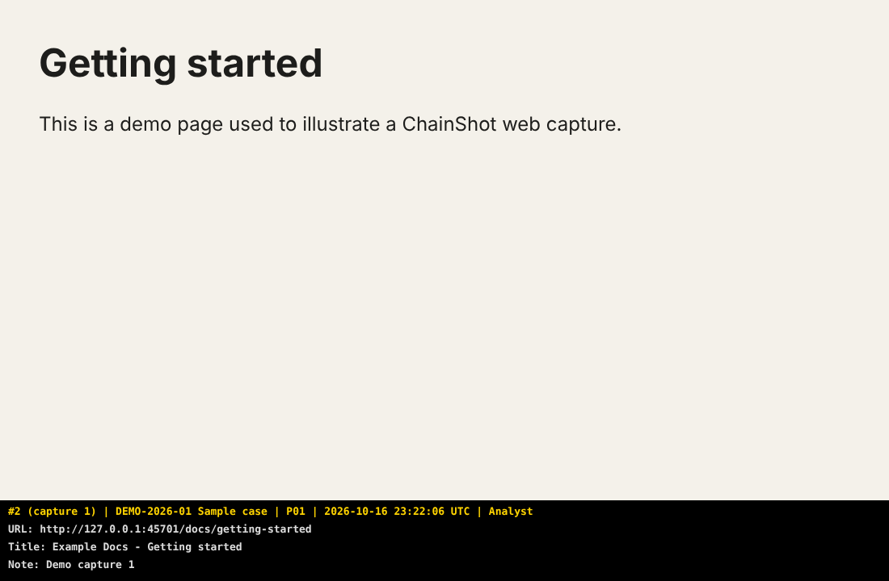

<p align="center">
  
</p>

<h1 align="center">ChainShot</h1>

<p align="center">
  <b>Captures d'écran horodatées et chaînées par hash, pour les rapports forensic et d'investigation.</b><br>
  Chaque capture est hachée, chaînée à la précédente, scellée et vérifiable par n'importe qui.
</p>

<p align="center"><a href="README.md">Read in English</a></p>

---

Une capture d'écran collée dans un rapport ne prouve rien à elle seule : elle peut être retouchée, re-datée ou
remplacée. ChainShot fait de chaque capture une preuve que n'importe qui peut contrôler plus tard :

- un **bandeau sous l'image** (jamais par-dessus) : n° d'entrée, cas, tag, heure UTC et locale, examinateur, poste ;
- le **SHA-256** du PNG, inscrit dans un journal en ajout seul ;
- une **chaîne de hash** qui couvre aussi l'heure, le tag et les notes : modifier, supprimer ou réordonner une entrée se voit ;
- des **scellés** qui certifient le journal à un instant donné, avec en option un **horodatage RFC 3161** par une autorité indépendante ;
- un **vérificateur qui n'a besoin que de Python** : le client ou l'auditeur n'a pas à faire confiance à l'outil de capture.

Le projet est né pendant un cours d'analyse forensic, d'un petit script PowerShell utilisé pour documenter une
analyse Autopsy, puis il est devenu une boîte à outils.

## Composants

| Composant | Plateforme | Rôle |
| --- | --- | --- |
| [**Module Windows et application de la zone de notification**](windows/) | Windows 10/11, PowerShell 5.1 ou 7 | Captures écran, fenêtre et zone avec raccourcis globaux, tags, notes, hachage de fichiers, vérification, scellés |
| [**Extension navigateur**](extension/) | Chrome, Edge, Brave (Chromium 116+) | Capture l'onglet visible avec son URL et son titre, écrit un cas ChainShot dans le dossier Téléchargements |
| [**`chainshot.py`**](python/) | Tout OS, Python 3.9+, sans dépendance | Implémentation de référence : vérification, scellés RFC 3161, rapport HTML, export CSV, ajout de fichiers et de notes |

Les trois écrivent **le même format de journal** ([spécification, en anglais](docs/journal-format.md)) et sont
testés sur les mêmes vecteurs : un cas commencé sous Windows peut être complété avec l'extension et vérifié partout.

| Capture web avec bandeau | Fenêtre de l'extension |
| --- | --- |
|  |  |


## Fonctionnement

1. **Capture** : l'image reçoit un bandeau *en dessous*, aucun pixel capturé n'est masqué.
2. **Hash** : le SHA-256 du PNG final est enregistré avec sa taille.
3. **Chaîne** : l'entrée (heure, type, tag, fichier, hash, examinateur, poste, URL, titre, note) est mise sous une
   forme canonique, hachée, puis combinée à la valeur de chaîne précédente. Modifier quoi que ce soit dans une entrée
   casse tous les maillons suivants.
4. **Scellé** : à tout moment (fin de session, avant remise), un scellé enregistre le nombre d'entrées, la dernière
   valeur de chaîne et le hash du journal à cet instant. Son SHA-256 est la valeur à écrire dans le rapport signé ou à
   envoyer au client par un autre canal.
5. **Horodatage** (optionnel) : le hash du scellé est envoyé à une autorité d'horodatage RFC 3161, qui le signe avec
   sa propre horloge. C'est la réponse à la principale faiblesse de l'horodatage local : l'horloge de votre PC.
6. **Vérification** : n'importe qui relance `chainshot.py verify` sur le dossier.

## Démarrage rapide

### Windows : module et application de la zone de notification

Téléchargez la dernière [release](https://github.com/Dalkin69/chainshot/releases) (`chainshot-windows-*.zip`), décompressez-la, puis :

```powershell
powershell -ExecutionPolicy Bypass -File .\Install-ChainShot.ps1          # -Startup pour la lancer à l'ouverture de session
New-ChainShotCase -Path D:\Cas\DEMO-01 -Case 'DEMO-01 Poste PC-042' -Examiner 'Votre nom'
```

Lancez **ChainShot** depuis le menu Démarrer. Une icône apparaît dans la zone de notification :

| Raccourci | Capture |
| --- | --- |
| `Ctrl+Alt+P` | écran sous la souris |
| `Ctrl+Alt+W` | fenêtre au premier plan (son titre et son processus sont enregistrés) |
| `Ctrl+Alt+R` | zone : l'écran se fige, tracez un rectangle, `Échap` annule |

Le menu de l'icône permet de définir le **tag** (par exemple `P17`), d'ajouter une **note** au journal, de
**hacher un fichier** (export Autopsy, image disque), de **vérifier** le cas, de le **sceller**, d'ouvrir le
**rapport HTML** et de changer de cas. Tout est aussi disponible en PowerShell :

```powershell
Set-ChainShotTag P17
Invoke-ChainShot -Mode Window -Delay 3 -Note 'Autopsy - Installed Programs'
Add-ChainShotFile -Path D:\Export\capture.pcap -Note 'Capture réseau exportée depuis Autopsy'
Add-ChainShotNote 'Début de la recherche par mots-clés sur le profil utilisateur'
Test-ChainShotCase
New-ChainShotSeal
Export-ChainShotReport -Open        # nécessite Python 3.9+
```

### Extension navigateur (Chrome, Edge, Brave)

1. Téléchargez `chainshot-extension-*.zip` depuis les [releases](https://github.com/Dalkin69/chainshot/releases) et décompressez-le
   (ou utilisez le dossier `extension/` d'un clone).
2. Ouvrez `chrome://extensions` (ou `edge://extensions`), activez le **Mode développeur**, cliquez sur
   **Charger l'extension non empaquetée** et sélectionnez le dossier.
3. Cliquez sur l'icône ChainShot, créez un cas, puis capturez avec le bouton ou `Alt+Maj+S`.

Le cas est écrit dans `Téléchargements/ChainShot/<cas>-<UTC>/`. Il contient les mêmes fichiers qu'un cas Windows et se
vérifie de la même façon. L'extension ne demande que `activeTab`, `downloads` et `storage` : elle ne peut capturer un
onglet que lorsque vous cliquez sur son bouton ou utilisez son raccourci.

> Si votre navigateur est réglé sur *« Toujours demander où enregistrer les fichiers »*, désactivez ce réglage
> pendant l'utilisation de ChainShot, sinon chaque fichier ouvre une boîte d'enregistrement.

### CLI Python (tout OS)

```bash
python chainshot.py init ./cas --case "DEMO-01" --examiner "Votre nom"
python chainshot.py add ./cas preuve.E01 --tag P00 --note "Image disque avant analyse"
python chainshot.py note ./cas "Début de l'analyse de la chronologie" --tag P05
python chainshot.py verify ./cas
python chainshot.py seal ./cas --tsa                 # horodatage RFC 3161 (par défaut : FreeTSA)
python chainshot.py report ./cas                     # ./cas/report/index.html
python chainshot.py export-csv ./cas                 # vue CSV en lecture seule
```

Installation comme commande : `pipx install "git+https://github.com/Dalkin69/chainshot#subdirectory=python"`,
ou copiez simplement le fichier.

## Vérifier un cas (client, auditeur)

Vous avez reçu un dossier de cas et un rapport qui indique le **SHA-256 d'un scellé**. Les outils de capture ne sont
pas nécessaires :

```bash
python chainshot.py verify chemin/du/cas                                  # fichiers, chaîne, scellés
python chainshot.py verify chemin/du/cas --tsa-ca freetsa-cacert.pem      # + signature RFC 3161 (nécessite openssl)
sha256sum chemin/du/cas/seals/seal-*.json                                 # à comparer avec la valeur du rapport
```

| Contrôle | Ce qu'il prouve |
| --- | --- |
| toutes les entrées `OK` | chaque fichier est exactement celui enregistré ; aucune entrée modifiée, supprimée, insérée ou déplacée |
| scellé `OK` | le journal correspond toujours à ce qui a été scellé, même si des entrées ont été ajoutées ensuite |
| SHA-256 du scellé = valeur du rapport signé | le cas est bien celui remis par l'examinateur |
| empreinte RFC 3161 `OK`, signature `valid` | le scellé existait à l'heure de l'autorité, indépendamment de l'horloge de l'examinateur |

Détails dans [docs/verification.md](docs/verification.md).

## Dossier de cas

```
DEMO-01/
├── chainshot-case.json       nom du cas, examinateur, date de création
├── journal.jsonl             une entrée JSON par ligne, en ajout seul (la preuve de référence)
├── captures/                 0002_20261016T080102345Z_P17.png ...
├── files/                    fichiers copiés dans le cas (optionnel)
├── seals/                    seal-<UTC>.json et seal-<UTC>.tsr (RFC 3161)
└── report/index.html         vue générée, pas une preuve
```

L'entrée `#1` de chaque journal est la note *Case created* : la première capture porte donc `#2 (capture 1)`. Le
numéro `#` est celui de l'entrée du journal, à citer dans un rapport.

N'ouvrez **pas** `journal.jsonl` dans Excel pour l'enregistrer : cela réécrit le fichier. Utilisez
`chainshot.py export-csv` pour une vue tableur.

La référence complète des commandes PowerShell et Python est dans le [README anglais](README.md#reference).

## Ce que ChainShot prouve, et ce qu'il ne prouve pas

**Il prouve** qu'un fichier est exactement celui enregistré dans le journal, que le journal n'a pas été modifié
après un scellé et, avec RFC 3161, que le scellé existait à une heure certifiée par un tiers.

**Il ne prouve pas** :

- que ce qui était à l'écran était vrai : ChainShot enregistre ce que vous avez vu, pas l'intégrité du système observé ;
- l'heure d'une entrée à elle seule : elle vient de l'horloge de l'examinateur. Gardez-la synchronisée et utilisez des
  scellés RFC 3161 pour ancrer le journal sur une heure externe ;
- quoi que ce soit si le hash du scellé n'est pas conservé hors du dossier : quelqu'un capable de réécrire tout le
  dossier peut fabriquer une nouvelle chaîne cohérente. Le SHA-256 du scellé doit figurer dans le rapport signé, ou
  être envoyé au client lors de la remise.

ChainShot rend les preuves **inaltérables de façon détectable** (*tamper-evident*), pas impossibles à altérer.
Conservez les cas sur des supports que vous contrôlez et suivez la procédure de chaîne de possession de votre
organisation. Voir [SECURITY.md](SECURITY.md).

## Tests

Chaque envoi déclenche l'ensemble des tests sur GitHub Actions ([workflow](.github/workflows/ci.yml)) :

| Suite | Environnements | Couvre |
| --- | --- | --- |
| Python `unittest` | Linux, Windows, macOS ; Python 3.9 et 3.13 | journal, scénarios d'altération, scellés, format v0, rapport, **RFC 3161 avec une vraie autorité d'horodatage OpenSSL** |
| Pester | Windows PowerShell 5.1, PowerShell 7 sous Windows et Linux | journal, altérations, scellés, **vraies captures écran, fenêtre et rectangle**, **application de notification et raccourcis**, interopérabilité avec Python dans les deux sens |
| Playwright | Chromium | extension chargée dans un vrai navigateur : capture, fichiers écrits par l'API de téléchargement, vérification par `chainshot.py`, détection d'altération, fenêtre |
| Vecteurs partagés | les trois | `tests/vectors/canonical-vectors.json` : texte canonique, hash d'entrée et chaîne identiques |

## Réalisé avec l'IA

Ce projet a été conçu et écrit avec **Claude** (l'assistant IA d'Anthropic), sous la direction de
[Dalkin69](https://github.com/Dalkin69), qui a défini les besoins à partir de travaux pratiques forensic réels, choisi
les fonctionnalités et validé le résultat. L'IA a écrit le code, les tests et la documentation ; chaque composant est
couvert par les tests automatisés décrits ci-dessus, exécutés sur de vraies machines Windows, Linux et macOS et dans
un vrai navigateur.

Comme pour tout outil utilisé en matière de preuve, relisez-le avant de vous y fier, et signalez les problèmes dans
les issues.

## Contribuer, sécurité, licence

- Les contributions sont bienvenues : voir [CONTRIBUTING.md](CONTRIBUTING.md).
- Problèmes de sécurité : voir [SECURITY.md](SECURITY.md).
- Licence : [MIT](LICENSE).
