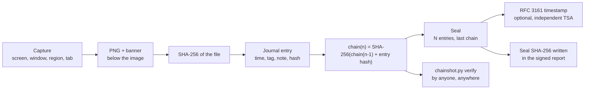

<p align="center">
  
</p>

<h1 align="center">ChainShot</h1>

<p align="center">
  <b>Timestamped, hash-chained screenshots for forensic and investigation reports.</b><br>
  Every capture is hashed, chained to the previous one, sealed and independently verifiable.
</p>

<p align="center">
  <a href="https://github.com/Dalkin69/chainshot/actions/workflows/ci.yml"></a>
  <a href="LICENSE"></a>
  
  
  
  <a href="#built-with-ai"></a>
</p>

<p align="center"><a href="README.fr.md">Lire en français</a></p>

---

A screenshot pasted into a report proves nothing on its own: it can be edited, re-dated or
swapped. ChainShot turns each capture into a piece of evidence that anyone can check later:

- a **banner under the image** (never over it) with the entry number, case, tag, UTC and local time, examiner and machine;
- a **SHA-256** of the PNG written to an append-only journal;
- a **hash chain** that also covers the time, tag and notes, so editing, removing or reordering any entry is detected;
- **seals** that certify the journal at a given moment, optionally with an **RFC 3161 timestamp** from an independent authority;
- a **verifier that needs nothing but Python**, so a client or auditor does not have to trust the tool that took the captures.

It was born during a digital forensics course, as a small PowerShell script used to document
an Autopsy analysis, and grew into a toolkit.

## Contents

- [Components](#components)
- [How it works](#how-it-works)
- [Quick start](#quick-start)
- [Verifying a case (client, auditor)](#verifying-a-case-client-auditor)
- [Case folder](#case-folder)
- [Reference](#reference)
- [What ChainShot proves, and what it does not](#what-chainshot-proves-and-what-it-does-not)
- [Testing](#testing)
- [Built with AI](#built-with-ai)
- [Contributing, security, license](#contributing-security-license)

## Components

| Component | Platform | What it does |
| --- | --- | --- |
| [**Windows module and tray app**](windows/) | Windows 10/11, PowerShell 5.1 or 7 | Screen, window and region captures with global hotkeys, tags, notes, file hashing, verification, seals |
| [**Browser extension**](extension/) | Chrome, Edge, Brave (Chromium 116+) | Captures the visible tab with its URL and title, writes a ChainShot case into your Downloads folder |
| [**`chainshot.py`**](python/) | Any OS, Python 3.9+, no dependency | Reference implementation: verify, seal with RFC 3161, HTML report, CSV export, add files and notes |

All three write the **same journal format** ([specification](docs/journal-format.md)) and are tested
against the same vectors, so a case started on Windows can be completed with the extension and
verified anywhere.

| Web capture with banner | Extension popup |
| --- | --- |
|  |  |


## How it works



1. **Capture**: the image gets a banner *below* it, so no captured pixel is hidden.
2. **Hash**: the SHA-256 of the final PNG is recorded with its size.
3. **Chain**: the entry (time, type, tag, file, hash, examiner, host, URL, title, note) is turned into a canonical
   text, hashed, and combined with the previous chain value. Changing anything in any entry breaks every following link.
4. **Seal**: at any point (end of a session, before delivery), a seal records how many entries exist, the last
   chain value and the hash of the journal at that point. Its SHA-256 is the value you put in your signed report
   or send to your client by another channel.
5. **Timestamp** (optional): the seal's hash is sent to an RFC 3161 Time-Stamping Authority, which signs it with
   its own clock. This removes the main weakness of local timestamps: your computer's clock.
6. **Verify**: anyone re-runs `chainshot.py verify` on the folder.

## Quick start

### Windows: module and tray application

Download the latest [release](https://github.com/Dalkin69/chainshot/releases) (`chainshot-windows-*.zip`), extract it, then:

```powershell
powershell -ExecutionPolicy Bypass -File .\Install-ChainShot.ps1          # add -Startup to launch the tray at logon
New-ChainShotCase -Path D:\Cases\DEMO-01 -Case 'DEMO-01 Workstation PC-042' -Examiner 'Your name'
```

Start **ChainShot** from the Start menu. A tray icon appears:

| Hotkey | Capture |
| --- | --- |
| `Ctrl+Alt+P` | screen under the mouse |
| `Ctrl+Alt+W` | foreground window (its title and process are recorded) |
| `Ctrl+Alt+R` | region: the screen freezes, draw a rectangle, `Esc` cancels |

The tray menu sets the **tag** (for example `P17`), adds a **note** to the journal, **hashes a file**
(an export from Autopsy, a disk image), **verifies** the case, **seals** it, opens the **HTML report**
and switches cases. Everything is also available from PowerShell:

```powershell
Set-ChainShotTag P17
Invoke-ChainShot -Mode Window -Delay 3 -Note 'Autopsy - Installed Programs'
Add-ChainShotFile -Path D:\Export\capture.pcap -Note 'Network capture exported from Autopsy'
Add-ChainShotNote 'Started keyword search on the user profile'
Test-ChainShotCase
New-ChainShotSeal
Export-ChainShotReport -Open        # needs Python 3.9+
```

### Browser extension (Chrome, Edge, Brave)

1. Download `chainshot-extension-*.zip` from the [releases](https://github.com/Dalkin69/chainshot/releases) and extract it
   (or use the `extension/` folder of a clone).
2. Open `chrome://extensions` (or `edge://extensions`), enable **Developer mode**, click **Load unpacked** and select the folder.
3. Click the ChainShot icon, create a case, then capture with the button or `Alt+Shift+S`.

The case is written to `Downloads/ChainShot/<case>-<UTC>/`. It contains the same files as a Windows case and is verified
the same way. The extension only asks for `activeTab`, `downloads` and `storage`: it can capture a tab only when you click
its button or press its shortcut.

> If your browser is set to *"Ask where to save each file"*, turn it off while using ChainShot, otherwise every file
> opens a save dialog.

### Python CLI (any OS)

```bash
python chainshot.py init ./case --case "DEMO-01" --examiner "Your name"
python chainshot.py add ./case evidence.E01 --tag P00 --note "Disk image before analysis"
python chainshot.py note ./case "Started timeline analysis" --tag P05
python chainshot.py verify ./case
python chainshot.py seal ./case --tsa                 # RFC 3161 timestamp (default TSA: FreeTSA)
python chainshot.py report ./case                     # ./case/report/index.html
python chainshot.py export-csv ./case                 # read-only CSV view
```

Install it as a command with `pipx install "git+https://github.com/Dalkin69/chainshot#subdirectory=python"`,
or just copy the single file.

## Verifying a case (client, auditor)

You received a case folder and a report that states a **seal SHA-256**. You do not need ChainShot's capture tools:

```bash
python chainshot.py verify path/to/case                                   # files, chain, seals
python chainshot.py verify path/to/case --tsa-ca freetsa-cacert.pem       # + RFC 3161 signature (needs openssl)
sha256sum path/to/case/seals/seal-*.json                                  # compare with the value in the report
```

| Check | What it proves |
| --- | --- |
| every entry `OK` | each file is exactly the one recorded; no entry was edited, removed, inserted or reordered |
| seal `OK` | the journal still matches what was sealed, even if entries were added afterwards |
| seal SHA-256 = value in the signed report | the case is the one the examiner delivered |
| RFC 3161 imprint `OK`, signature `valid` | the seal existed at the TSA's time, independently of the examiner's clock |

More details in [docs/verification.md](docs/verification.md).

## Case folder

```
DEMO-01/
├── chainshot-case.json       case name, examiner, creation time
├── journal.jsonl             one JSON entry per line, append-only (the evidence of record)
├── captures/                 0002_20261016T080102345Z_P17.png ...
├── files/                    files copied into the case (optional)
├── seals/                    seal-<UTC>.json and seal-<UTC>.tsr (RFC 3161)
└── report/index.html         generated view, not evidence
```

Entry `#1` of every journal is the *Case created* note, so the first capture is `#2 (capture 1)`: the `#` number is
the journal entry, the one to quote in a report.

Do **not** open `journal.jsonl` in Excel and save it: that rewrites the file. Use `chainshot.py export-csv` for a spreadsheet view.

## Reference

<details>
<summary><b>PowerShell commands</b></summary>

| Command | Purpose |
| --- | --- |
| `New-ChainShotCase -Path -Case [-Examiner]` | create a case and select it |
| `Set-ChainShotCase -Path` | select an existing case |
| `Set-ChainShotTag -Tag` | tag for the next entries (persists across reboots) |
| `Get-ChainShotStatus` | current case, tag, number of entries |
| `Invoke-ChainShot [-Mode Screen\|AllScreens\|Window\|Region] [-Rectangle 'x,y,w,h'] [-Delay s] [-Note] [-Tag]` | capture |
| `Add-ChainShotFile -Path [-Copy] [-Note] [-Tag]` | hash a file into the journal |
| `Add-ChainShotNote -Text [-Tag]` | text-only entry |
| `Read-ChainShotJournal` | journal entries as objects |
| `Test-ChainShotCase [-Quiet]` | verify files, chain and seals |
| `New-ChainShotSeal` | seal the journal |
| `Export-ChainShotReport [-Open]` | HTML report (calls `chainshot.py`) |
| `Start-ChainShotTray` | tray application and hotkeys |
| `Install-ChainShotShortcut [-Startup]` | Start menu / Startup shortcuts |

Every command takes `-CasePath` to work on a case other than the current one.
</details>

<details>
<summary><b><code>chainshot.py</code> commands</b></summary>

| Command | Purpose |
| --- | --- |
| `init <case> --case NAME [--examiner NAME]` | create a case |
| `add <case> <file> [--tag] [--note] [--copy]` | hash a file into the journal |
| `note <case> TEXT [--tag]` | text-only entry |
| `verify <case> [--tsa-ca PEM] [--json]` | verify; exit code 0 = intact, 1 = problem, 2 = error |
| `seal <case> [--tsa [URL]]` | seal, optionally with an RFC 3161 timestamp |
| `report <case> [-o FILE] [--tsa-ca PEM]` | HTML report |
| `export-csv <case> [-o FILE]` | CSV view of the journal |
| `tsr-info <file.tsr>` | show the content of a timestamp |

`verify` also checks journals produced by the original `Capture-Preuve.ps1` script (`journal_preuves.csv`, format v0).
</details>

<details>
<summary><b>Journal entry example</b></summary>

```json
{"v":"1","seq":"2","utc":"2026-10-16T08:01:02.345Z","type":"screenshot","tag":"P17",
 "file":"captures/0002_20261016T080102345Z_P17.png","size":"183442",
 "sha256":"9f2c...","examiner":"Analyst","host":"LAB-PC","source":"chainshot-ps/1.0.0",
 "url":"","title":"Autopsy 4.21.0","note":"Installed Programs",
 "local":"2026-10-16T10:01:02+02:00","extra":{"mode":"Window","process":"autopsy64"},"chain":"4b1e..."}
```
</details>

## What ChainShot proves, and what it does not

**It proves** that a file is exactly the one recorded in the journal, that the journal was not altered after a seal,
and, with RFC 3161, that the seal existed at a time certified by a third party.

**It does not prove**:

- that what was on screen was true: ChainShot records what you saw, not the integrity of the system you looked at;
- the time of an entry by itself: entry times come from the examiner's clock. Keep it synchronised, and use RFC 3161
  seals to anchor the journal to an external time;
- anything if the seal hash is not kept outside the folder: someone able to rewrite the whole folder can build a new
  consistent chain. The seal SHA-256 must be in your signed report, or sent to the client when you deliver.

ChainShot makes evidence **tamper-evident**, not tamper-proof. Store cases on media you control, and follow your
organisation's chain-of-custody procedure. See [SECURITY.md](SECURITY.md).

## Testing

Every push runs the full test suite on GitHub Actions ([workflow](.github/workflows/ci.yml)):

| Suite | Runs on | Covers |
| --- | --- | --- |
| Python `unittest` | Linux, Windows, macOS; Python 3.9 and 3.13 | journal, tampering scenarios, seals, legacy v0, report, **RFC 3161 with a real OpenSSL timestamp authority** |
| Pester | Windows PowerShell 5.1, PowerShell 7 on Windows and Linux | journal, tampering, seals, **real screen/window/rectangle captures**, **tray app and hotkey registration**, interoperability with Python in both directions |
| Playwright | Chromium | extension loaded in a real browser: capture, files written by the downloads API, verification by `chainshot.py`, tamper detection, popup |
| Shared vectors | all three | `tests/vectors/canonical-vectors.json`: identical canonical text, entry hashes and chain values |

Run them locally:

```bash
python -m unittest discover -s python/tests -v
pwsh -c "Invoke-Pester ./windows/tests"
npm install && npx playwright install chromium && npm run test:extension
```

## Built with AI

This project was designed and written with **Claude** (Anthropic's AI assistant), under the direction of
[Dalkin69](https://github.com/Dalkin69), who defined the needs from real forensic coursework, chose the
features and validated the result. The AI wrote the code, tests and documentation; every component is covered by
the automated tests described above, which run on real Windows, Linux and macOS machines and in a real browser.

As with any tool used for evidence, review it before relying on it, and report problems through the issues.

## Contributing, security, license

- Contributions are welcome: see [CONTRIBUTING.md](CONTRIBUTING.md). Changes to the journal format must update the
  specification, the three implementations and the shared vectors together.
- Security issues: see [SECURITY.md](SECURITY.md).
- License: [MIT](LICENSE).
