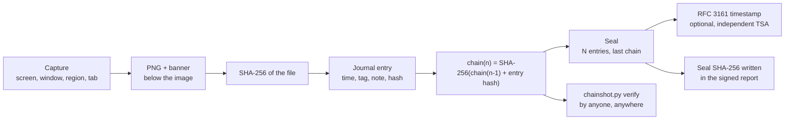

<p align="center">
  
</p>

<h1 align="center">ChainShot</h1>

<p align="center">
  <b>Timestamped, hash-chained screenshots for forensic and investigation reports.</b><br>
  Every capture is hashed, chained to the previous one, sealed and independently verifiable.
</p>

<p align="center">
  <a href="https://github.com/Dalkin69/chainshot/actions/workflows/ci.yml"></a>
  <a href="LICENSE"></a>
  
  
  
  
  <a href="https://dalkin69.github.io/chainshot/privacy.html"></a>
</p>

<p align="center">
  <a href="https://dalkin69.github.io/chainshot/"><b>Website</b></a> ·
  <a href="https://github.com/Dalkin69/chainshot/releases/latest">Download</a> ·
  <a href="https://chromewebstore.google.com/detail/chainshot-forensic-web-ca/ejbdnnlgcnogepeclpknfagfhehkhgap">Chrome Web Store</a> ·
  <a href="https://addons.mozilla.org/firefox/addon/chainshot-forensic-captures/">Firefox Add-ons</a>
</p>

---

A screenshot pasted into a report proves nothing on its own: it can be edited, re-dated or
swapped. ChainShot turns each capture into a piece of evidence that anyone can check later:

- a **banner under the image** (never over it) with the entry number, case, tag, UTC and local time, examiner and machine;
- a **SHA-256** of the PNG written to an append-only journal;
- a **hash chain** that also covers the time, tag and notes, so editing, removing or reordering any entry is detected;
- **seals** that certify the journal at a given moment, optionally with an **RFC 3161 timestamp** from an independent authority;
- a **verifier that needs nothing but Python**, so a client or auditor does not have to trust the tool that took the captures.

It started as a small PowerShell script written during a digital forensics course to document an Autopsy analysis.

> **Private by design.** No telemetry, no analytics, no account, no update check: ChainShot never connects to the
> internet on its own and captures never leave your computer. The only network request is the optional RFC 3161
> timestamp, which sends the SHA-256 of a seal file and nothing else
> ([privacy policy](https://dalkin69.github.io/chainshot/privacy.html)).

## Contents

- [Components](#components)
- [Screenshots](#screenshots)
- [How it works](#how-it-works)
- [Install and use](#install-and-use)
- [Delivering and verifying a case](#delivering-and-verifying-a-case)
- [Journal format](#journal-format)
- [Reference](#reference)
- [What ChainShot proves, and what it does not](#what-chainshot-proves-and-what-it-does-not)
- [Development](#development)

## Components

| Component | Platform | What it does |
| --- | --- | --- |
| **ChainShot app** ([`app/`](app/), `ChainShot.exe`) | Windows 10/11, single file, nothing to install | Cases, screen/window/region captures with global hotkeys, tags, notes, file hashing by drag and drop, journal with filter and preview, verification, seals with RFC 3161, HTML report, evidence package, tray icon, command line |
| **PowerShell module** ([`windows/`](windows/)) | Windows PowerShell 5.1 and PowerShell 7 | The same features as commands, for scripts, with its own tray app |
| **Browser extension** ([`extension/`](extension/)) | Chrome, Edge, Brave (Chromium 116+), Firefox 140+ | Visible area or **whole page** with URL and title, optional **MHTML archive** (Chromium), into its own case or straight into the case open in the app |
| **`chainshot.py`** ([`python/`](python/)) | Any OS, Python 3.9+, no dependency | Reference implementation and independent verifier: verify, seal with RFC 3161, HTML report, CSV export, evidence package |

All four write the **same journal format** and are tested against the same vectors
(`tests/vectors/`), so a case started in the app can be continued from PowerShell or the browser and
verified anywhere.

## Screenshots

**The app**: case header with the verification badge, tag and note of the next capture, the journal and the
preview of the selected capture.


**A modified file is caught**: the same case after a few bytes of one capture were changed.


| Web capture with its banner (extension) | HTML report |
| --- | --- |
|  |  |

## How it works



1. **Capture**: the image gets a banner *below* it, so no captured pixel is hidden.
2. **Hash**: the SHA-256 of the final PNG is recorded with its size.
3. **Chain**: the entry (time, type, tag, file, hash, examiner, host, URL, title, note) is turned into a canonical
   text, hashed and combined with the previous chain value: changing anything breaks every following link.
4. **Seal**: a seal records how many entries exist, the last chain value and the hash of the journal at that point.
   Its SHA-256 goes into your signed report, or to your client by another channel.
5. **Timestamp** (optional): the seal's hash is signed by an RFC 3161 Time-Stamping Authority with its own clock.
6. **Verify**: anyone re-runs `chainshot.py verify` on the folder.

## Install and use

### Windows app

```powershell
scoop bucket add chainshot https://github.com/Dalkin69/chainshot; scoop install chainshot
winget install Dalkin69.ChainShot          # once accepted in the winget catalog
```

Or download `chainshot-app-*.zip` from the [latest release](https://github.com/Dalkin69/chainshot/releases/latest),
check it against `SHA256SUMS.txt`, extract it and start `ChainShot.exe` (no installation, no admin rights; .NET
Framework 4.8 is part of Windows 10 1903+ and 11). The executable is not code-signed: if SmartScreen warns you,
click **More info > Run anyway**.

1. **New case...**: a name or reference, the examiner, the parent folder.
2. Type a **tag** (the step or question you document, e.g. `P17`), then capture with the buttons or, from any application:

   | Hotkey | Capture |
   | --- | --- |
   | `Ctrl+Alt+P` | screen under the mouse |
   | `Ctrl+Alt+W` | foreground window (title and process recorded) |
   | `Ctrl+Alt+R` | region: the screen freezes, draw a rectangle, `Esc` cancels |

3. Drop files on the window to hash them (exports, logs, disk images), add **notes**, then **Verify**,
   **Seal + timestamp**, **HTML report** and, to deliver, **Export package**.

Closing the window keeps ChainShot in the notification area with its hotkeys. Settings live in
`%APPDATA%\ChainShot`; the browser link, start with Windows and the Start menu shortcut are added only when you ask.
ChainShot then lists itself in **Settings > Apps > Installed apps**, and uninstalling it there (or *Options >
Uninstall from this computer*, `ChainShot.exe uninstall --delete-exe`) removes everything it added. Case folders are
never touched.

### PowerShell module

Download `chainshot-powershell-*.zip` from the release, extract it, then:

```powershell
powershell -ExecutionPolicy Bypass -File .\Install-ChainShot.ps1          # -Startup: start its tray at logon
New-ChainShotCase -Path D:\Cases\DEMO-01 -Case 'DEMO-01 Workstation PC-042' -Examiner 'Your name'
Set-ChainShotTag P17
Invoke-ChainShot -Mode Window -Delay 3 -Note 'Autopsy - Installed Programs'
Add-ChainShotFile -Path D:\Export\capture.pcap -Note 'Network capture exported from Autopsy'
Test-ChainShotCase
New-ChainShotSeal
Start-ChainShotTray                 # tray icon with the same hotkeys (not together with the app)
```

The module shares the current case and tag with the app. It is listed in Installed apps as *ChainShot PowerShell
module*, from where `Uninstall-ChainShot.ps1` removes it.

### Browser extension

Install it from the [Chrome Web Store](https://chromewebstore.google.com/detail/chainshot-forensic-web-ca/ejbdnnlgcnogepeclpknfagfhehkhgap)
(Chrome, Edge, Brave) or [Firefox Add-ons](https://addons.mozilla.org/firefox/addon/chainshot-forensic-captures/).
Click its icon, create a case, then capture with the button or `Alt+Shift+S`. **Full page** scrolls and stitches the
whole page; **Page archive** adds an MHTML copy of the page next to the image (Chromium).

Captures go to `Downloads/ChainShot/<case>-<UTC>/`, or, with **ChainShot app** selected in the popup, into the case
open in the Windows app (or in `chainshot.py use <case>` on Linux and macOS, after `chainshot.py register-browser`).
The extension has no host permission: it captures a tab only after your click or shortcut and sends nothing over
the network.

### Python

```bash
pipx install "git+https://github.com/Dalkin69/chainshot#subdirectory=python"     # or copy the single file
chainshot init ./case --case "DEMO-01" --examiner "Your name"
chainshot add ./case evidence.E01 --tag P00 --note "Disk image before analysis"
chainshot note ./case "Started timeline analysis" --tag P05
chainshot verify ./case
chainshot seal ./case --tsa                 # RFC 3161 timestamp (default TSA: FreeTSA)
chainshot report ./case                     # ./case/report/index.html
```

## Delivering and verifying a case

**Export package** (app), `ChainShot.exe package`, `chainshot.py package` or `Export-ChainShotPackage` builds one zip:

```
DEMO-01-package-20261017T091500Z.zip
├── DEMO-01/              the case folder: journal, captures, files, seals, report
├── chainshot.py          the independent verifier (standard Python, no dependency)
├── VERIFY.txt            what to check and how, with the seal SHA-256 and the journal SHA-256
└── SHA256SUMS.txt        SHA-256 of every file of the package
```

The case must verify to be packaged (the app offers to seal it first). The zip's SHA-256 is recorded in the journal:
send it to the recipient by another channel, or write it in your report.

**Verifying** (client, auditor, court expert) needs only Python 3.9+, and OpenSSL for the optional signature check.
Get `chainshot.py` from the releases rather than from the case folder, then:

```bash
python chainshot.py verify path/to/case                                   # files, chain, seals
python chainshot.py verify path/to/case --tsa-ca freetsa-cacert.pem       # + RFC 3161 signature
sha256sum path/to/case/seals/seal-*.json                                  # compare with the report
openssl ts -verify -in seal-X.tsr -data seal-X.json -CAfile freetsa-cacert.pem   # manual check
```

| Result | Meaning |
| --- | --- |
| every entry `OK`, `RESULT: ALL EVIDENCE INTACT` (exit 0) | each file is the one recorded; no entry was edited, removed, inserted or reordered |
| `FILE HASH MISMATCH` / `FILE MISSING` | a file was modified, re-saved, cropped, or is gone |
| `CHAIN BROKEN` | the journal itself was changed (time, tag, note, order, a removed line) |
| seal mismatch | the journal is not the one that was sealed |
| one seal's SHA-256 = the value in the signed report | the case is the one the examiner delivered |
| RFC 3161 imprint `OK`, signature `valid` | the seal existed at the authority's time, whatever the examiner's clock said |

A warning about a timestamp earlier than the previous entry usually means the examiner's clock was changed: ask
about it, it is not proof of tampering by itself. The FreeTSA CA certificate is published at
`https://freetsa.org/files/cacert.pem`.

## Journal format

<details>
<summary><b>Specification, version 1</b> (shared by the four implementations)</summary>

**Case folder**

```
<case>/
├── chainshot-case.json       case name, examiner, creation time (not chained)
├── journal.jsonl             one JSON entry per line, append-only: the evidence of record
├── captures/                 NNNN_<UTC>_<tag>.png (.mhtml for page archives)
├── files/                    files copied into the case (optional)
├── seals/                    seal-<UTC>.json, seal-<UTC>.tsr (RFC 3161)
└── report/index.html         generated view, not evidence
```

**Entries.** `journal.jsonl` is UTF-8 without BOM, one object per line ending with `\n` (readers accept a BOM and
`\r\n`). Chained values are strings; missing values are empty strings. Chained fields, in this order:
`v` (`"1"`), `seq` (1-based position), `utc` (`YYYY-MM-DDTHH:MM:SS.mmmZ`), `type` (`screenshot`, `browser`, `file`,
`note`, `seal`, `timestamp`), `tag`, `file` (relative to the case with `/`, or absolute), `size`, `sha256` (lowercase
hex), `examiner`, `host`, `source` (tool and version), `url`, `title`, `note`. `local` (local time with offset) and
`extra` (tool details) are informative and not chained; `chain` holds the chain value.

**Canonical text and chain.**

```
canonical(n)  = join("\n", [name + "=" + sanitize(value) for name in CHAINED_FIELDS])   # sanitize: CR and LF -> space
entry_hash(n) = hex(SHA-256(UTF-8(canonical(n))))
chain(0)      = "0" * 64
chain(n)      = hex(SHA-256(UTF-8(chain(n-1) + entry_hash(n))))
```

No other normalisation (no trimming, no Unicode normalisation); writers store the sanitized values.

**Verification**, for each line `n`: valid JSON with `v == "1"`; `seq == str(n)`; `chain` equals the recomputed
`chain(n)`; if `file` is set, the file exists with the recorded SHA-256 and size.

**Seals.** `seals/seal-<UTC>.json` records `entries` (N), `last_chain` (`chain(N)`) and `journal_prefix_sha256`
(SHA-256 of the first N lines as raw bytes). A seal is valid when both still match, so it survives later appends and
catches a journal rebuilt with a consistent chain. A `seal` entry is then appended, whose `sha256` is the seal
file's hash: the value to put in the signed report.

**RFC 3161.** A TimeStampReq (SHA-256, nonce, certificate requested) for the seal file's hash is sent to the
authority; the DER response is stored as `seals/seal-<UTC>.tsr` and a `timestamp` entry is appended. The token's
`messageImprint` must equal the seal's SHA-256 (checked without dependencies); the signature is checked with
OpenSSL when the authority's CA certificate is given.

**Legacy v0.** `journal_preuves.csv` from the original `Capture-Preuve.ps1` is still verified:
`ChainHash(n) = SHA-256(ChainHash(n-1) + SHA256(file n))` (only file hashes are chained; a warning says so).

`tests/vectors/canonical-vectors.json` is the executable contract: generated by `chainshot.py`, checked by the
tests of the three other implementations.
</details>

<details>
<summary><b>Browser link</b> (extension → app, native messaging)</summary>

The browser starts the host on the same computer and talks to it on its standard input and output (no network):
`ChainShot.exe` on Windows (registered by the app, asked at first start) or `chainshot.py native-host`
(`chainshot.py register-browser`). The manifest `com.chainshot.host` allows only the ChainShot extension IDs; the
registry keys are under `HKCU\Software\<browser>\NativeMessagingHosts\` on Windows, and in the browsers'
`NativeMessagingHosts` folders on Linux and macOS (Firefox: its own manifest with `allowed_extensions`).

Messages are length-prefixed UTF-8 JSON (protocol 2): `hello` (current case, tag, next numbers), `set_tag`,
`capture` (PNG with `expected_seq`, or `format: "mhtml"`), `note`, `verify`. The extension draws the banner with
the number given by the host; if another tool added an entry meanwhile, the host answers `retry` and the banner is
redrawn, so the number on the image always matches the journal. The host checks the PNG signature and size
(60 MB max), keeps a fixed set of fields and ignores a browser clock more than 10 minutes off.
</details>

## Reference

<details>
<summary><b><code>ChainShot.exe</code> commands</b></summary>

| Command | Purpose |
| --- | --- |
| `ChainShot.exe [--minimized]` | open the application (in the tray with `--minimized`) |
| `new-case <folder> --case NAME [--examiner NAME]` | create a case and select it |
| `tag [TAG]` | show or set the tag of the next entries |
| `capture [--mode screen\|all\|window\|region] [--rect x,y,w,h] [--delay s] [--tag] [--note]` | capture |
| `add <file>... [--copy] [--tag] [--note]` | hash files into the journal |
| `note TEXT [--tag]` | text-only entry |
| `verify [<case>] [--json]` | verify; exit code 0 = intact, 1 = problem, 2 = error |
| `seal [<case>] [--tsa [URL]]` | seal, optionally with an RFC 3161 timestamp |
| `report [<case>] [--out FILE] [--open]` | HTML report |
| `use [<case>]` | show or set the current case (shared with the module and `chainshot.py`) |
| `package [<case>] [--out FILE.zip] [--seal] [--tsa [URL]]` | evidence package for delivery |
| `register-browser [--extension-id ID] [--remove]` | browser link for the extension |
| `uninstall [--keep-settings] [--delete-exe] [--gui]` | remove everything ChainShot added (not the cases) |
| `selftest <vectors.json>` | check the implementation against the shared vectors |

Commands use the current case unless `--case <folder>` is given. From PowerShell, add `| Out-Host` so the prompt
waits for the result.
</details>

<details>
<summary><b>PowerShell commands</b></summary>

| Command | Purpose |
| --- | --- |
| `New-ChainShotCase -Path -Case [-Examiner]` | create a case and select it |
| `Set-ChainShotCase -Path` / `Set-ChainShotTag -Tag` | select a case / set the tag |
| `Get-ChainShotStatus` | current case, tag, number of entries |
| `Invoke-ChainShot [-Mode Screen\|AllScreens\|Window\|Region] [-Rectangle 'x,y,w,h'] [-Delay s] [-Note] [-Tag]` | capture |
| `Add-ChainShotFile -Path [-Copy] [-Note] [-Tag]` / `Add-ChainShotNote -Text [-Tag]` | file / text entry |
| `Read-ChainShotJournal` / `Test-ChainShotCase [-Quiet]` | read / verify the journal |
| `New-ChainShotSeal` | seal the journal |
| `Export-ChainShotReport [-Open]` / `Export-ChainShotPackage [-Seal] [-Timestamp]` | report / package (call `chainshot.py`) |
| `Start-ChainShotTray` / `Install-ChainShotShortcut [-Startup]` | tray application / its shortcuts |

Every command takes `-CasePath` to work on another case than the current one.
</details>

<details>
<summary><b><code>chainshot.py</code> commands</b></summary>

| Command | Purpose |
| --- | --- |
| `init <case> --case NAME [--examiner NAME]` | create a case |
| `add <case> <file> [--tag] [--note] [--copy]` / `note <case> TEXT [--tag]` | file / text entry |
| `verify <case> [--tsa-ca PEM] [--json]` | verify; exit code 0 = intact, 1 = problem, 2 = error |
| `seal <case> [--tsa [URL]]` | seal, optionally with an RFC 3161 timestamp |
| `report <case> [-o FILE]` / `export-csv <case>` | HTML report / CSV view |
| `tsr-info <file.tsr>` | content of a timestamp token |
| `package <case> [-o FILE.zip] [--seal] [--tsa [URL]]` | evidence package |
| `use [<case>]`, `tag [TAG]` | current case and tag (shared with the app and the module) |
| `register-browser [--extension-id ID] [--remove]` | `chainshot.py` as the browser link host |
</details>

## What ChainShot proves, and what it does not

**It proves** that a file is exactly the one recorded in the journal, that the journal was not altered after a seal,
and, with RFC 3161, that the seal existed at a time certified by a third party.

**It does not prove** that what was on screen was true (it records what you saw, not the integrity of the system you
looked at), nor the time of an entry by itself (entry times come from the examiner's clock; RFC 3161 seals anchor the
journal to an external time and ChainShot warns when the local clock is more than a minute off). Someone able to
rewrite the whole folder can build a new consistent chain: the seal SHA-256 must be kept outside it.

ChainShot makes evidence **tamper-evident**, not tamper-proof. Follow your organisation's chain-of-custody procedure.

## Development

Every push runs the tests on GitHub Actions: `ChainShot.exe` end-to-end on a real Windows desktop (captures, RFC 3161
against an OpenSSL authority, browser link, uninstall), Python on Linux, Windows and macOS, Pester on Windows
PowerShell 5.1 and PowerShell 7, the extension in Chromium (Playwright) and Firefox (Selenium, Mozilla's linter),
and CodeQL. A release is built from a tag by the release workflow, with `SHA256SUMS.txt`.

```bash
python -m unittest discover -s python/tests -v
pwsh -c "Invoke-Pester ./windows/tests"
npm install && npx playwright install chromium && npm run test:extension
dotnet build app/ChainShot.csproj -c Release && python tests/app_e2e.py app/bin/Release/ChainShot.exe   # Windows
python tools/build_extension.py --out dist                                                            # store packages
```

Changes to the journal format must update this specification, the four implementations and the shared vectors
together. Security problems: [SECURITY.md](SECURITY.md).

Designed by [Dalkin69](https://github.com/Dalkin69) from real forensic coursework and written with Claude
(Anthropic's AI assistant). License: [MIT](LICENSE).
